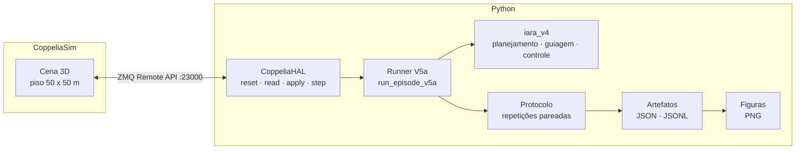
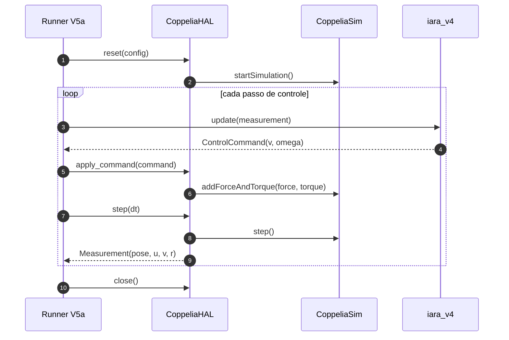

<div align="center">

# 🌊 IARA V5a

### Simulação 3D, HAL e validação de controle no CoppeliaSim

**Python · ZMQ Remote API · CoppeliaSim · controle dinâmico · métricas reprodutíveis**

[](https://www.python.org/)
[](https://www.coppeliarobotics.com/)
[](https://manual.coppeliarobotics.com/en/zmqRemoteApiOverview.htm)
[](#testes)
[](https://www.ieee-ras.org/)

</div>

> [!NOTE]
> **Escopo deste README:** exclusivamente o **V5a** e suas dependências diretas. O diretório `iara_v4/` é consumido como núcleo de controle congelado; ele não é o objeto deste documento.

O **IARA V5a** é a camada de simulação 3D do veículo autônomo de superfície IARA. Ele conecta o núcleo de planejamento, guiagem e controle a uma planta física no **CoppeliaSim**, expõe essa planta por um **Hardware Abstraction Layer (HAL)** e produz artefatos de experimento prontos para análise estatística e geração de figuras.

O resultado é uma pilha reproduzível na qual a matemática de controle permanece independente do simulador, enquanto a física 3D, os atuadores e as forças virtuais ficam isolados na camada de hardware.

---

## Sumário

- [Visão geral](#visão-geral)
- [Arquitetura](#arquitetura)
- [Estrutura do repositório](#estrutura-do-repositório)
- [Requisitos](#requisitos)
- [Instalação](#instalação)
- [Início rápido](#início-rápido)
- [HAL e física](#hal-e-física)
- [Protocolo e métricas](#protocolo-e-métricas)
- [Testes](#testes)
- [Resultado de referência](#resultado-de-referência)
- [Limitações](#limitações)
- [Documentação](#documentação)
- [Solução de problemas](#solução-de-problemas)

---

## Visão geral

O V5a adiciona ao núcleo de controle uma planta 3D realista o suficiente para validar a integração completa:

- **`CoppeliaHAL`**: ponte ZMQ entre Python e CoppeliaSim, com leitura de pose/velocidade e aplicação de forças no barco.
- **Runner de episódios**: executa um episódio completo usando somente a HAL injetada.
- **Protocolo de repetições**: repete cada célula `(condition, scenario, seed)` e agrega média/desvio-padrão, porque o simulador não é determinístico bit-a-bit.
- **Artefatos padronizados**: `v5a1_protocol.json` e `episodes.jsonl` para auditoria e geração de figuras.
- **Testes com mocks**: a suíte do V5a roda sem abrir o CoppeliaSim.

### Status do V5a

| Camada | Estado |
| :--- | :---: |
| HAL do CoppeliaSim | ✅ implementado |
| Runner de episódios | ✅ validado em simulação |
| Protocolo de repetições | ✅ implementado |
| Testes unitários | ✅ 81 passed |
| Geração de figuras | ✅ validada |
| Validação física do barco real | ⏳ fora do escopo |

---

## Arquitetura



<details>
<summary><strong>Ver o loop de controle em detalhe</strong></summary>

<br/>



</details>

---

## Estrutura do repositório

```text
V5a/
├── iara_v5a/
│   ├── hal/
│   │   ├── base.py              # contrato HardwareHAL
│   │   └── coppelia.py          # implementação ZMQ + forças virtuais
│   ├── runner/
│   │   ├── episode.py           # loop de um episódio
│   │   └── protocol.py          # repetições e agregação
│   ├── experiments/configs/     # v5a1_smoke.yaml, v5a1_validation.yaml
│   ├── estimation/              # reservado para o EKF
│   ├── sensing/                 # reservado para sensores
│   └── tests/                   # testes do HAL e do runner
├── iara_v4/                     # núcleo de controle (dependência congelada)
├── scripts/                     # experimentos, smoke, diagnóstico e figuras
├── docs/                        # documentação técnica
├── experiments/                 # resultados e figuras geradas
├── tests/                       # suíte do núcleo de controle
├── IAR-CPS-0001-26- CENA DO IARA LUA V0.3.ttt
└── pyproject.toml
```

---

## Requisitos

| Dependência | Versão / observação |
| :--- | :--- |
| **Python** | 3.10 ou superior |
| **CoppeliaSim** | Edu 4.6 ou superior |
| **ZMQ Remote API** | ativa em `localhost:23000` |
| **`coppeliasim-zmqremoteapi-client`** | instalação explícita (ver abaixo) |
| **NumPy, SciPy, PyYAML, Matplotlib** | instalados por `pip install -e .` |
| **Git e pip** | para clonar e instalar o projeto |

> [!IMPORTANT]
> O cliente ZMQ não está declarado nas dependências do `pyproject.toml`, porque só é necessário quando o CoppeliaSim está disponível. Por isso ele é instalado explicitamente no passo seguinte.

---

## Instalação

```bash
git clone https://github.com/seu-usuario/Gain-Scheduling-Simulation.git
cd Gain-Scheduling-Simulation/V5a
```

> [!TIP]
> Substitua `seu-usuario` pela sua conta ou organização no GitHub.

Crie e ative o ambiente virtual:

```bash
# Windows
python -m venv .venv
.venv\Scripts\activate

# Linux / macOS
python3 -m venv .venv
source .venv/bin/activate
```

Instale o projeto e o cliente ZMQ:

```bash
python -m pip install --upgrade pip
python -m pip install -e .
python -m pip install coppeliasim-zmqremoteapi-client
```

---

## Início rápido

### 1. Rode os testes

```bash
pytest -q
```

> [!TIP]
> Resultado esperado: **`81 passed`** — 12 testes do V5a e 69 testes do núcleo de controle. Os testes do HAL usam mocks e não precisam do CoppeliaSim aberto.

### 2. Prepare o CoppeliaSim

1. Abra o CoppeliaSim.
2. Abra a cena `IAR-CPS-0001-26- CENA DO IARA LUA V0.3.ttt`.
3. Confirme que o servidor **ZMQ Remote API** está ativo na porta `23000`.
4. Deixe a simulação **pausada**.

> [!WARNING]
> Não clique em **Play** antes de executar o script. O runner controla o modo de stepping e inicia a simulação pela API.

### 3. Execute o smoke de validação

Com a cena já aberta:

```bash
python scripts/run_v5a1_experiment.py --config iara_v5a/experiments/configs/v5a1_smoke.yaml --repetitions 1
```

Ou deixe o próprio script carregar a cena:

```bash
python scripts/run_v5a1_experiment.py --config iara_v5a/experiments/configs/v5a1_smoke.yaml --scene "IAR-CPS-0001-26- CENA DO IARA LUA V0.3.ttt" --repetitions 1
```

Os artefatos são gravados em:

```text
experiments/results/v5a1/v5a1_protocol.json
experiments/results/v5a1/episodes.jsonl
```

### 4. Gere as figuras

```bash
python scripts/generate_figures.py --results experiments/results/v5a1 --scenario coppelia_default --conditions pp
```

As imagens ficam em `experiments/results/v5a1/figures/`. A figura principal é:

```text
experiments/results/v5a1/figures/trajectories_coppelia_default.png
```

Nela, a linha **pontilhada** é o caminho planejado e a linha **sólida** é a trajetória executada.

---

## HAL e física

O `CoppeliaHAL` implementa o contrato `HardwareHAL`:

| Método | Responsabilidade |
| :--- | :--- |
| `reset(config)` | carrega a cena quando `scene_path` é informado, descobre os handles e inicia o stepping |
| `read_measurement()` | lê pose, `u` (surge), `v` (sway) e `r` (yaw rate) do barco |
| `apply_command(command)` | converte `v`/`omega` em comandos dos thrusters e aplica as forças virtuais |
| `step(dt)` | avança um passo síncrono do CoppeliaSim |
| `is_running()` | retorna o tempo corrente da simulação |
| `close()` | encerra a simulação e libera a conexão |

Como o CoppeliaSim não simula fluidodinâmica real, o barco é apoiado em um piso sólido de **50 m x 50 m** que representa a superfície da água. Para que o movimento seja compatível com o controle, a HAL aplica três efeitos virtuais no referencial do corpo:

| Efeito | Eixo | Função | Saturação |
| :--- | :---: | :--- | :---: |
| **`force_forward`** | X (surge) | acelera/freia e compensa o arrasto simulado | ±60 N |
| **`force_side`** | Y (sway) | resistência lateral que se opõe à derrapagem | ±60 N |
| **`torque_z`** | Z (yaw) | torque diferencial de guinada | ±0.5 N·m |

> [!WARNING]
> Os ganhos e limites acima foram calibrados empiricamente e fazem parte do contrato da planta. Alterá-los invalida a validação no CoppeliaSim. Veja [`docs/V5A1_LIMITATIONS.md`](docs/V5A1_LIMITATIONS.md) antes de modificar qualquer valor.

---

## Protocolo e métricas

O runner repete cada célula experimental `(condition, scenario, seed)` por `n_repetitions` vezes. Isso é necessário porque o motor de física do CoppeliaSim não garante repetibilidade bit-a-bit.

| Artefato | Conteúdo |
| :--- | :--- |
| `v5a1_protocol.json` | container completo com episódios, agregados e chaves pareadas |
| `episodes.jsonl` | um episódio por linha, consumido pelo script de figuras |
| `figures/*.png` | trajetórias, RMSE, tempo, esforço de leme, yaw rate e outras métricas |

A métrica `max_speed` é calculada a partir do **pico de `u`** devolvido pela HAL durante todo o episódio, e não apenas do último sample.

---

## Testes

```bash
pytest -q
```

Resultado atual:

```text
81 passed
```

| Arquivo | Cobertura |
| :--- | :--- |
| `iara_v5a/tests/test_coppelia_hal.py` | força lateral oposta à velocidade de derrapagem |
| `iara_v5a/tests/test_coppelia_hal_import.py` | contrato do HAL, thrusters e distúrbios |
| `iara_v5a/tests/test_runner_integration.py` | contrato do runner e pico de `max_speed` |
| `iara_v5a/tests/test_hal_contract.py` | protocolo `HardwareHAL` em tempo de execução |

Para rodar apenas a suíte do V5a:

```bash
pytest -q iara_v5a/tests
```

---

## Resultado de referência

Smoke de referência com o controlador **Pure Pursuit** (`pp`), cenário `coppelia_default`, seed `11` e uma repetição:

| Métrica | Valor |
| :--- | ---: |
| `success` | ✅ `true` |
| `timeout` | ❌ `false` |
| `tracking_rmse` | **0.0300 m** |
| `max_speed` | **0.2363 m/s** |
| `time` | 18.05 s |
| `steps` | 360 |

> [!NOTE]
> Esse é um resultado de validação da cena e da integração, não uma validação física do IARA real. As forças virtuais são hipóteses de simulação calibradas para esta cena.

---

## Limitações

| Limitação | Impacto | Mitigação |
| :--- | :--- | :--- |
| CoppeliaSim não é determinístico bit-a-bit | pequenas variações entre execuções | repetições e agregação por célula |
| Água representada por piso sólido | sem ondas, empuxo ou massa adicionada | não interpretar como hidrodinâmica identificada |
| Forças `force_forward` e `force_side` são PID virtual | não são curvas reais de thruster | calibração documentada e congelada |
| Sem `PiHAL`, EKF ou VFH+ com sensores reais | escopo restrito à simulação | ver documento de limitações e handoff |
| `set_disturbance` ligado à API de forças | rejeição a distúrbios ainda não demonstrada | validar em execução dedicada antes de afirmar |

A descrição completa está em [`docs/V5A1_LIMITATIONS.md`](docs/V5A1_LIMITATIONS.md).

---

## Documentação

| Documento | Conteúdo |
| :--- | :--- |
| [`docs/V5A1_LIMITATIONS.md`](docs/V5A1_LIMITATIONS.md) | forças virtuais, piso sólido, determinismo e escopo |
| [`docs/V5A1_TO_V5A2.md`](docs/V5A1_TO_V5A2.md) | handoff técnico e pontos de extensão |
| [`docs/MATHEMATICAL_FOUNDATIONS.md`](docs/MATHEMATICAL_FOUNDATIONS.md) | fundamentos matemáticos do núcleo de controle |
| [`docs/PROTOCOL.md`](docs/PROTOCOL.md) | protocolo experimental e critérios de reprodutibilidade |

---

## Solução de problemas

<details>
<summary><strong>HALError: could not connect to CoppeliaSim</strong></summary>

<br/>

Verifique se o CoppeliaSim está aberto e se o servidor ZMQ Remote API está ativo na porta `23000`. Em seguida, rode o diagnóstico:

```bash
python scripts/v5a1_diagnose_scene.py
```

</details>

<details>
<summary><strong>HALError: missing CoppeliaSim object</strong></summary>

<br/>

Os caminhos esperados são:

```text
/Cuboid
/Cuboid/Dummy_thrusterLeft/thrusterJoint_left
/Cuboid/Dummy_thrusterRight/thrusterJoint_right
```

Confira os nomes reais com o script de diagnóstico e ajuste o `CoppeliaHALConfig` se necessário.

</details>

<details>
<summary><strong>ModuleNotFoundError: coppeliasim_zmqremoteapi_client</strong></summary>

<br/>

Instale o cliente explicitamente:

```bash
python -m pip install coppeliasim-zmqremoteapi-client
```

</details>

<details>
<summary><strong>O barco não se move</strong></summary>

<br/>

Confirme que:

1. os dois thrusters estão em **velocity mode**;
2. a simulação estava pausada antes do runner iniciar;
3. os handles do barco e dos thrusters correspondem à cena aberta;
4. o `propeller_radius` e o `track_width` estão coerentes com o modelo.

</details>

---

<div align="center">

**IARA V5a** · IEEE RAS IARA

<sub>Simulação 3D para pesquisa em controle de veículos autônomos de superfície.</sub>

</div>
